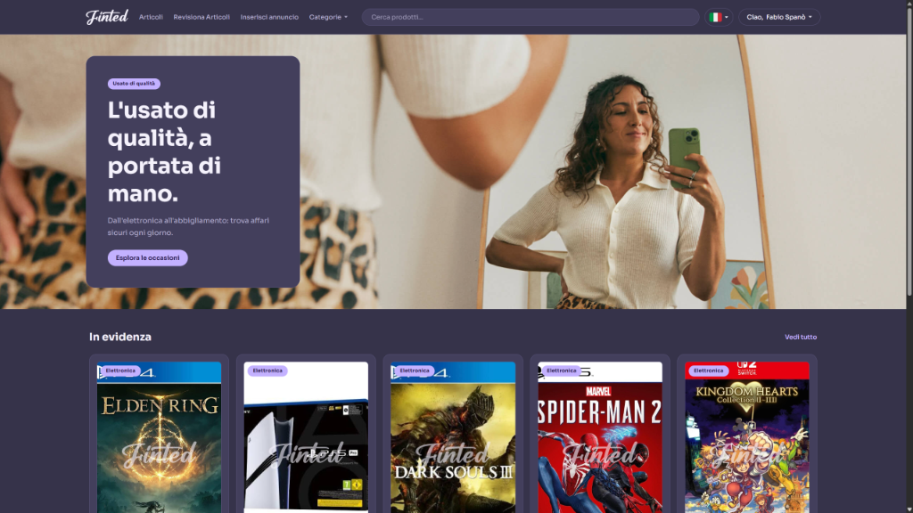
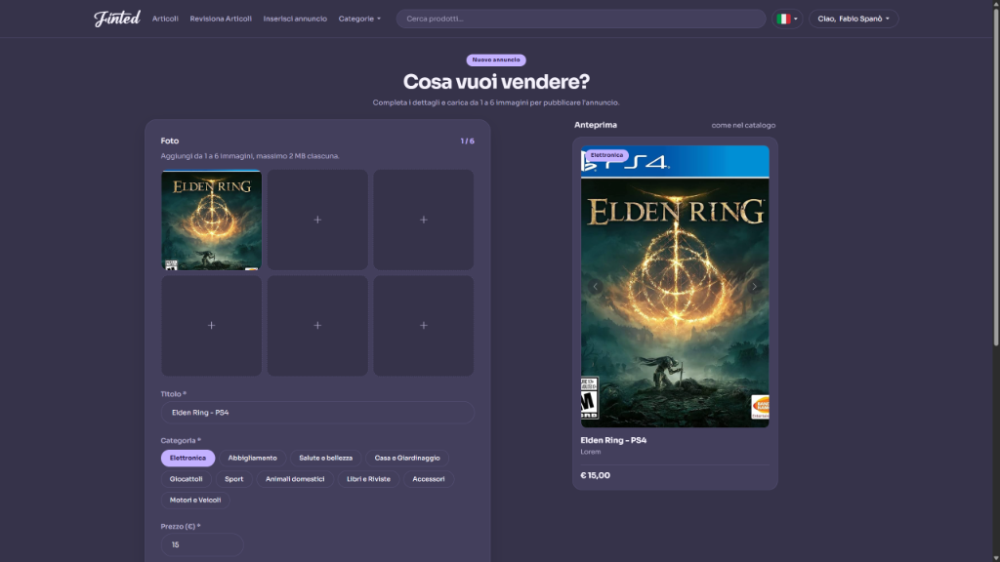
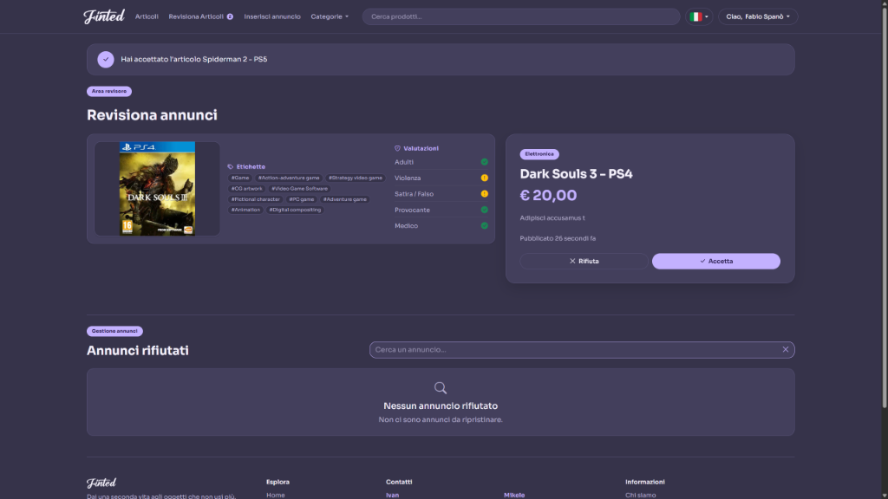
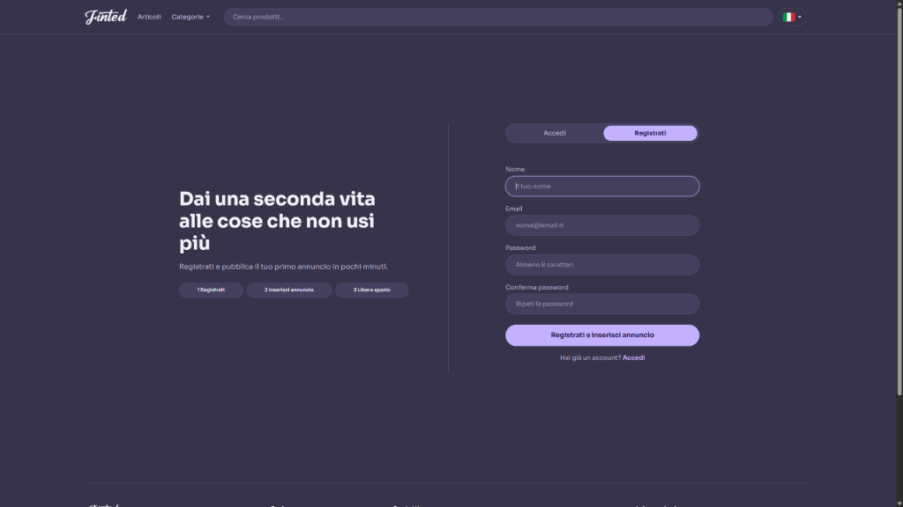

# Finted



Second-hand marketplace web application built with Laravel and Livewire: defined routes with dedicated controllers and dynamic components for real-time catalog interactions. Registered users can browse items by category, filter listings through a full-text search index, and publish articles using a reactive form with multiple photo uploads and an instant preview card. Background workers handle image watermarking and resizing. Submitted listings go through an automated Google Cloud Vision check that extracts descriptive labels and flags potential policy violations for adult, violent, or spoof content. A dedicated revisor area allows assigned moderators to inspect submissions, verify the safety scores, and accept or reject articles. The application supports multi-language localization and core flows are covered by an automated Pest test suite.

## Screenshots






## Installation and setup

```bash
composer setup
npm run dev
```

```bash
composer install
cp .env.example .env
php artisan key:generate
php artisan migrate
php artisan storage:link
npm install
npm run build
php artisan serve
```
